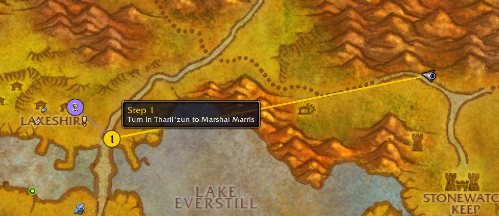
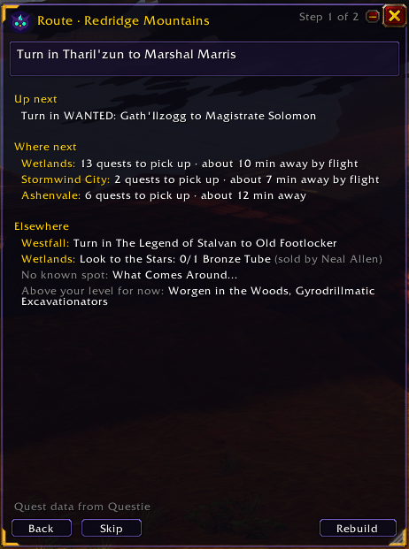
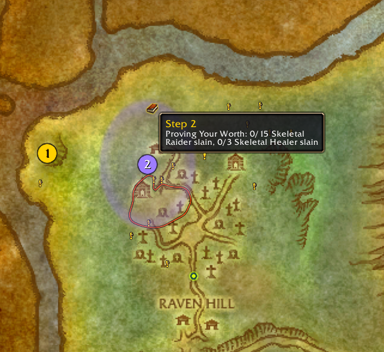
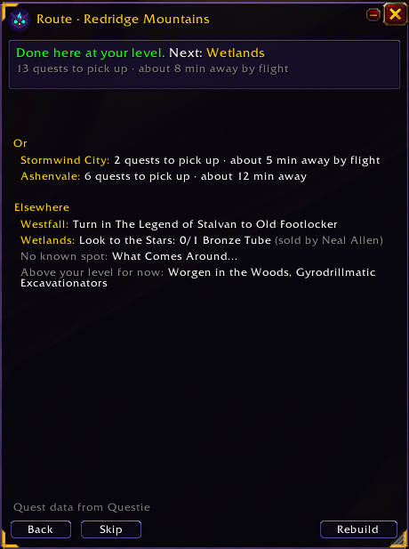
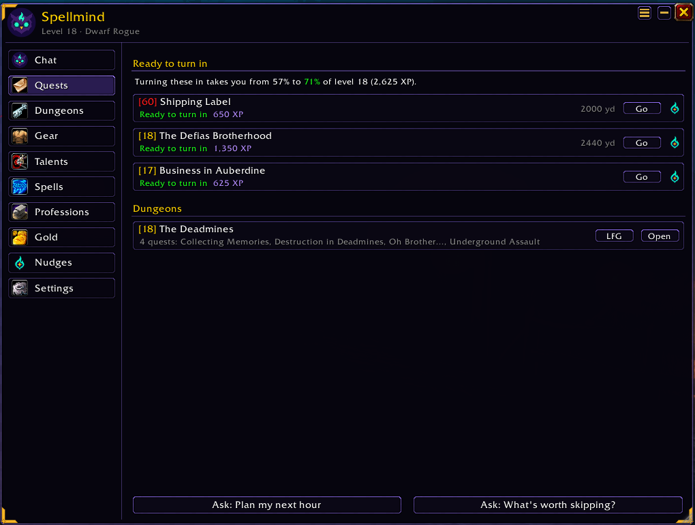
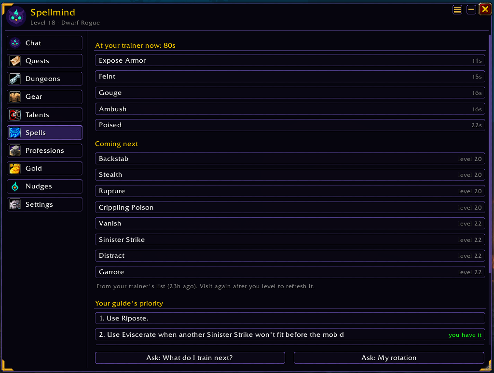
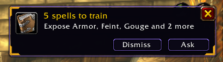
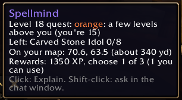
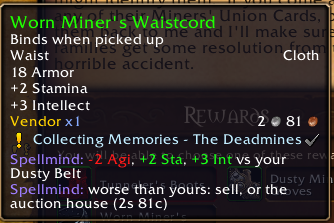
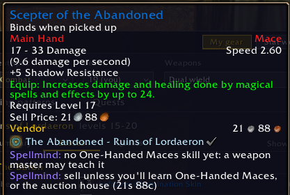

<p align="center">
  
</p>

<h1 align="center">Spellmind: AI Companion</h1>

<p align="center">
  An AI companion for <b>World of Warcraft: Forever</b>. It knows your character as you play and helps with what you're deciding: your quest route, dungeons, gear, talents, spells, professions and gold.<br>
  <b>Free and open source. Advice only: it never plays for you.</b>
</p>

<p align="center">
  <a href="https://github.com/jcouser/spellmind/releases/latest">Download the app</a> ·
  <a href="https://www.curseforge.com/wow/addons/spellmind-ai-companion">The addon on CurseForge</a> ·
  <a href="docs/install.md">Install guide</a> ·
  <a href="docs/privacy.md">Privacy</a> ·
  <a href="docs/screen-reading.md">How it reads the game</a> ·
  <a href="docs/faq.md">FAQ</a>
</p>

<p align="center">
  
</p>

> **Unofficial.** Spellmind isn't made, reviewed or endorsed by Blizzard Entertainment. World of Warcraft is a trademark of Blizzard Entertainment, Inc.

## What it does

Spellmind is two parts:

- **The addon**, in the game. It works on its own, with no app and no AI: a quest route built from your own quest log, what your quests lead to, which dungeons fit your level, gear and bag advice, talents to take next, spells to train, profession caps and gold. Quiet nudges by the minimap tell you when something's waiting.
- **The free desktop app** (Windows 10 and 11). It sends your question, with the game data you allow, to **your own AI**, and brings the answer back into the game's chat window.

| | Addon alone | Addon + app |
|---|---|---|
| The quest route: your steps, an arrow, the world map and minimap, where to go next | ✓ | ✓ |
| Quests, Dungeons, Gear, Talents, Spells, Professions, Gold tabs | ✓ | ✓ |
| Tooltip lines, nudges, waypoints on click | ✓ | ✓ |
| Chat: ask anything about your character | | ✓ |
| "Break it down" on quests, items, trainers and merchants | | ✓ |
| "Review my route": what to skip, and why | | ✓ |
| Read your leveling guide's page (talents, rotation) | | ✓ |

### Your quest route

Turn it on in the **Route tab**. Spellmind plans your leveling from your own quest log and where you stand: every pickup, objective and turn-in around you, in the shortest order, ticked off the moment you finish it. Follow-up quests are planned after the turn-in that opens them, and quests above your level wait until you're ready (or in a group).

- **Never lose your way:** an arrow on screen points to your next step with the yards to it. The world map numbers the steps, shades where each objective is and draws a line from you through them. The minimap shows the current step, with a thin line to it along the roads you've walked (a switch on the Route tab turns the lines off).
- **Always know where to go next:** when a zone runs dry, Spellmind ranks the best zones for your level by the quests actually left for you, counting the flight paths you know and your hearthstone.
- **Ask about it:** with the app, your AI sees the same route. "Review my route" says what to skip and why.

Works best with [Questie](https://www.curseforge.com/wow/addons/questie) installed: it adds the quests to pick up and where the mobs are. Without it, the route covers the quests in your log.

<table>
  <tr>
    <td width="58%"></td>
    <td width="42%"></td>
  </tr>
  <tr>
    <td></td>
    <td></td>
  </tr>
</table>

### Ask your AI, in game

<table>
  <tr>
    <td width="55%"></td>
    <td width="45%"></td>
  </tr>
  <tr>
    <td><b>Break it down:</b> click the Spellmind mark on a quest, an item, a trainer or a merchant, and your AI explains that exact thing.</td>
    <td><b>Chat:</b> ask about your gear, bags, route, talents or gold. Shift-click items and quests into the box; the buttons under an answer ask the obvious next question.</td>
  </tr>
</table>

Things to ask:

- "Should I take [Dusty Mining Gloves] from this quest?"
- "What should I do next here?" or "Plan my next hour"
- "What in my bags is worth selling on the Auction House?"
- "Plan my next 5 talent points"

Answers use your real character: your gear, quest log, talents, gold and where you are. When an answer sends you somewhere it knows the coordinates of, a **Pin** button under it sets the game's map pin and arrow. With web search on, your AI can check quest and NPC details online, and answers that name places, NPCs or routes are double-checked before you see them (a switch in Settings turns that off).

### The panel, no AI needed

<table>
  <tr>
    <td width="50%"></td>
    <td width="50%"></td>
  </tr>
  <tr>
    <td><b>Quests:</b> what to turn in, what to do now and here, and what's worth skipping, with Go to set a waypoint.</td>
    <td><b>Dungeons:</b> which dungeons your quests are for, the questlines that lead there, and what's at your level.</td>
  </tr>
  <tr>
    <td></td>
    <td></td>
  </tr>
  <tr>
    <td><b>Gear:</b> upgrades within reach from your quests' rewards, your weakest slots, and what your bags are good for.</td>
    <td><b>Spells:</b> what to train now and what it costs, what's coming, and your guide's rotation.</td>
  </tr>
  <tr>
    <td></td>
    <td></td>
  </tr>
  <tr>
    <td><b>Talents:</b> your leveling guide's build, read by your AI, with the next points to take.</td>
    <td><b>Settings:</b> every mark and nudge has its own switch, and you choose which game data your AI gets.</td>
  </tr>
  <tr>
    <td align="center"></td>
    <td align="center"></td>
  </tr>
  <tr>
    <td><b>Nudges:</b> a quiet toast by the minimap when something's waiting: spells to train, points to spend, gear about to break.</td>
    <td><b>Tooltips:</b> Spellmind's lines on quests and items: difficulty, what's left, upgrades, and what to sell, with its vendor price.</td>
  </tr>
  <tr>
    <td align="center"></td>
    <td align="center"></td>
  </tr>
  <tr>
    <td><b>On items:</b> better or worse than what you wear, by how much, and what to do with it, with its vendor price.</td>
    <td><b>Knows your skills:</b> a weapon you can't use yet but can learn says so, instead of just "sell".</td>
  </tr>
  <tr>
    <td colspan="2" align="center"></td>
  </tr>
  <tr>
    <td colspan="2"><b>Minimap button:</b> click for the chat, right-click for your last tab. <code>/sm minimap off</code> hides it.</td>
  </tr>
</table>

Also in the panel:

- **Professions:** what to do next for each profession, and when it's near its cap.
- **Gold:** what came in and went out this session and today (and per hour), what's coming up (spells to train, repairs), and what your bags are worth at a vendor, and on the Auction House from Auctionator's last scan if you have Auctionator.

#### In the game's own windows

- **Quest log:** Spellmind's mark on a quest's details. Hover for its level against yours, what's left, where it is and its rewards; click to have your AI break it down.
- **Item tooltips:** better or worse than what you wear and by how much, whether you can use it, and what to do with it, with its vendor price.
- **Quest rewards:** which reward to pick when you turn a quest in.
- **Character sheet:** a dot on a slot that has a better item waiting in your bags.
- **Merchant** and **class trainer:** what to sell, and what to train first.

#### Nudges

A small toast by the minimap, never in combat and never a stream of them: spells to train, talent points to spend, gear about to break, bags nearly full, a dungeon you just entered, quests ready to turn in, professions near their cap. Each kind has its own switch, and **Dismiss** means not again for the same thing.

### The app

<p>
  
</p>

Pick your AI, its model and thinking level. It sits by the clock while you play, keeps the addon up to date and updates itself.

## Your AI, your choice

The app talks to the AI you pick. You pay that AI (or use a plan you already have); Spellmind itself is free and has no account, server or subscription.

- **ChatGPT plan** (Plus or Pro): sign in in your browser, no API key.
- **An API key** for Claude (Anthropic), ChatGPT (OpenAI), Grok (xAI) or Gemini (Google).
- **Other:** any OpenAI-compatible service, such as OpenRouter or Groq, or a model on your own computer with Ollama or LM Studio.

Keys and sign-ins stay in Windows' Credential Manager on your PC. The game never sees them.

## Install

**The addon:** from [CurseForge](https://www.curseforge.com/wow/addons/spellmind-ai-companion) (WoW Forever), or the `Spellmind-<version>.zip` on the [releases page](https://github.com/jcouser/spellmind/releases/latest), unzipped into `World of Warcraft\_forever_\Interface\AddOns`. The zip carries the addon and its parts (`Spellmind_S001` to `Spellmind_S200`, which bring answers in); keep them all.

**The app:** `Spellmind-Setup-<version>.exe` from the [releases page](https://github.com/jcouser/spellmind/releases/latest). It needs no admin rights, finds your WoW folder, installs the addon if it isn't there, and walks you through setting up your AI. [The install guide](docs/install.md) covers checking the download, the SmartScreen warning, updating and removing it.

Spellmind works alongside Questie and Auctionator, and uses their data when they're installed, but needs neither. It's made for WoW Forever (1.60.1).

## Commands

| Command | What it does |
|---|---|
| `/sm` | Open or close the chat |
| `/sm quests`, `dungeons`, `gear`, `talents`, `spells`, `professions`, `gold`, `settings` | Open that tab |
| `/sm <question>` | Ask your AI (with the app) |
| `/sm app` | Where to get the free app |
| `/sm route` | The quest route on or off (the Route tab has its switches) |
| `/sm route why <step>` | Why a step is where it is: what must come before it, and how long the route would be with it earlier |
| `/sm arrow` | The route's arrow on or off |
| `/sm news` | What's new in this version |
| `/sm welcome` | The first-time welcome again |
| `/sm guide <link>` | Import your leveling guide (with the app) |
| `/sm nudges on`, `off`, `reset` | The nudges |
| `/sm marks on`, `off` | Spellmind's marks on the game's windows and its tooltip lines |
| `/sm minimap on`, `off` | The minimap button |
| `/sm help` | All the commands |

## Privacy, in short

- **Never sent:** your character's name, realm or guild, your account, other players' names or chat.
- **Sent to your AI only, when you ask:** your question and the game data you allow (class, level, gear, quests, talents and so on; each part has a switch in Settings).
- **Nothing goes to the Spellmind authors.** No telemetry, no analytics, no server.

The details are in [docs/privacy.md](docs/privacy.md).

## How it works

An addon can't reach the internet or write files while you play, so the two parts talk through the screen and the addon folder:

1. The addon draws a small strip of colored squares in the corner of the game's window, holding your question.
2. The app reads only that strip, from the game's window, and sends the question to your AI. [What it reads, and what it doesn't](docs/screen-reading.md).
3. The answer comes back as files in the addon's own folders, which the addon loads.

The app never reads the game's memory, never sends keys or clicks, and never changes the game's files outside Spellmind's own addon folders. [The design notes](docs/design.md) have more.

## Building from source

Node 22.19 or newer.

```
npm ci
npm test                              # the addon (in a Lua VM), the app's core and the link
node tools/package-addon.mjs          # dist/Spellmind-<version>.zip, for CurseForge
cd app/desktop && npm ci && npm start # the app from source
npm run dist                          # (in app/desktop) the Windows installer and its SHA-256
```

The app's screen-reading helper is C, built with `npm run capture:build` (Git Bash with MinGW-w64's gcc) or `core/capture/windows/build.sh` (Zig 0.16.0). Releases are built by [GitHub Actions](.github/workflows/release.yml) from a tagged commit; [docs/releasing.md](docs/releasing.md) has the steps.

## Code signing policy

The Windows installer is unsigned for now, so Windows SmartScreen warns on its first run: check each download against its SHA-256 ([install guide](docs/install.md)). The project applied to [SignPath Foundation](https://signpath.org)'s free signing for open-source projects in November 2026; they asked it to come back once it has more of a community, and it will.

When it's signed: *Free code signing provided by [SignPath.io](https://about.signpath.io), certificate by [SignPath Foundation](https://signpath.org).*

- **Only this project's own files are signed:** the installer built from this repository's source by [the release workflow](.github/workflows/release.yml) on GitHub's own runners, from a tagged commit.
- **Committers and reviewers:** [jcouser](https://github.com/jcouser). Changes from anyone else come as pull requests and are reviewed before they're merged.
- **Approvers:** [jcouser](https://github.com/jcouser) approves each signing request by hand.
- **Privacy:** Spellmind sends nothing to the Spellmind authors. It sends your questions and the game data you allow to the AI you chose, only when you ask, and checks this repository's releases for new versions (a switch turns that off). See [docs/privacy.md](docs/privacy.md).

## Support and security

- Questions and bugs: [GitHub issues](https://github.com/jcouser/spellmind/issues). Leave out your character's name, keys and anything personal.
- Security problems: see [SECURITY.md](SECURITY.md); please don't open a public issue.

## License

MIT, see [LICENSE](LICENSE). Parts come from NeverQuestAlone and wow-ai under the MIT license: see [NOTICE](NOTICE.md). The Spellmind name and artwork aren't covered by the license.
