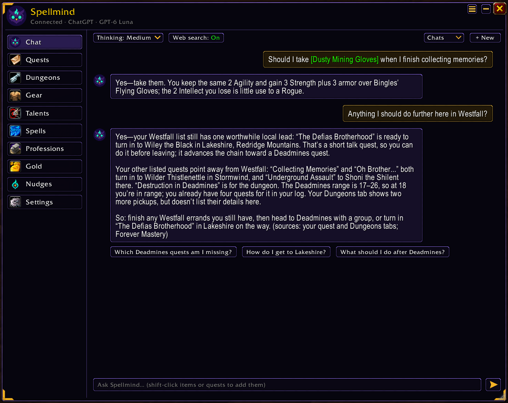
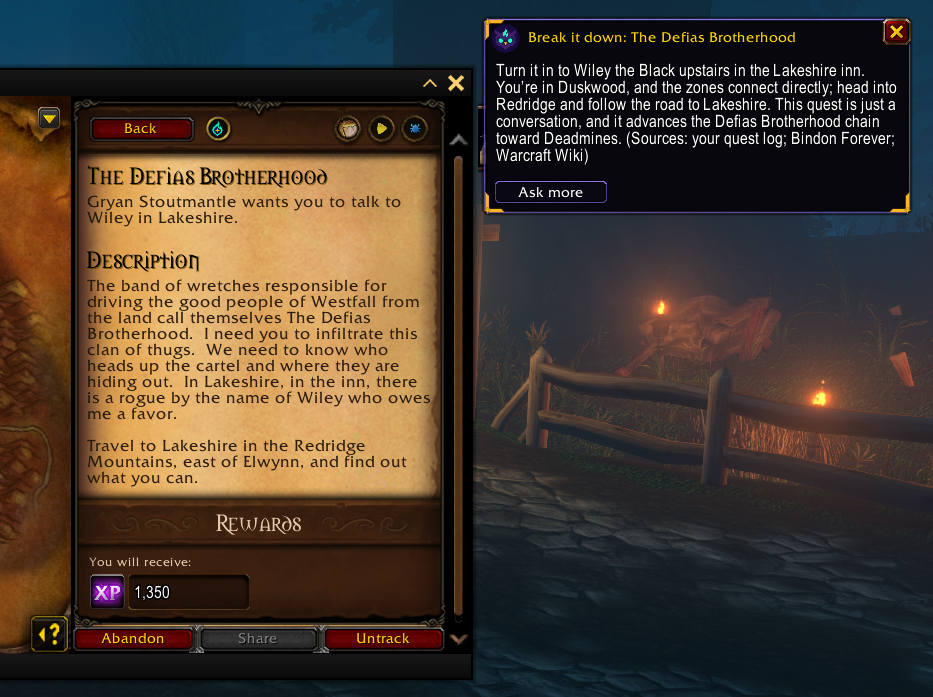
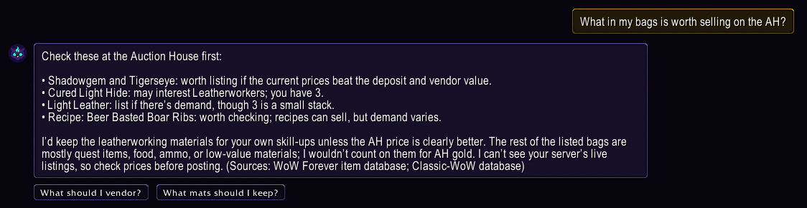
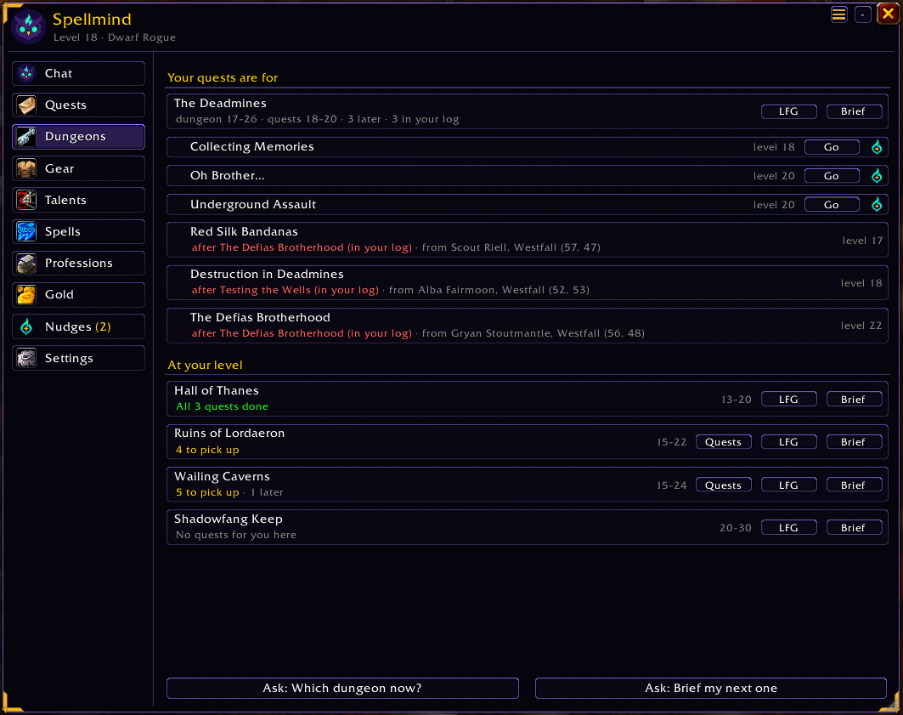
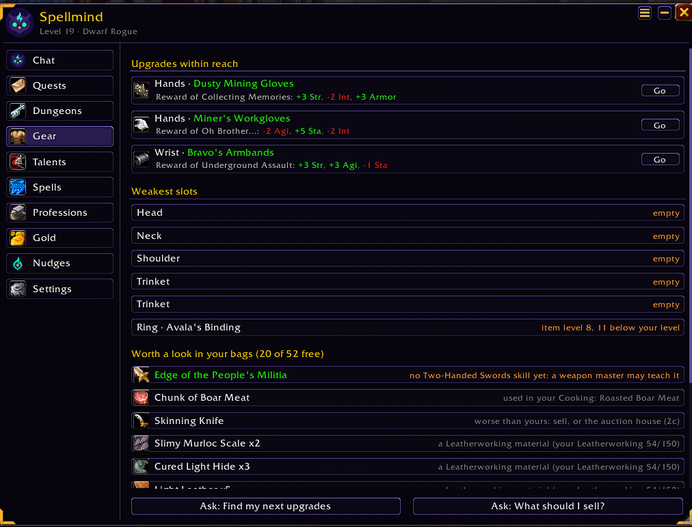
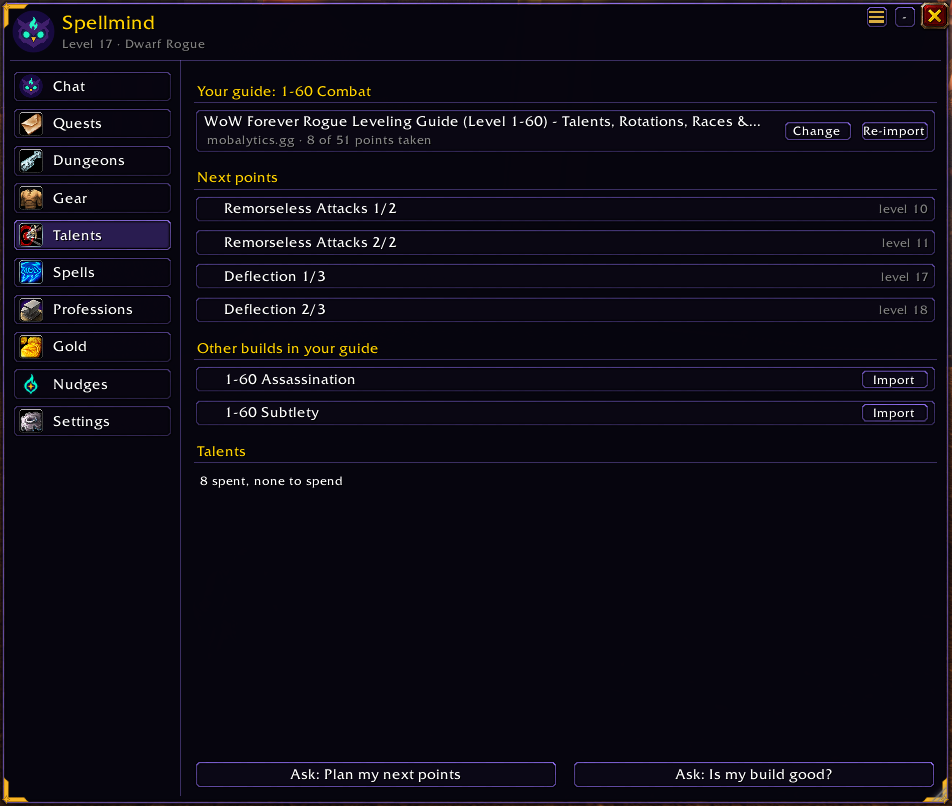
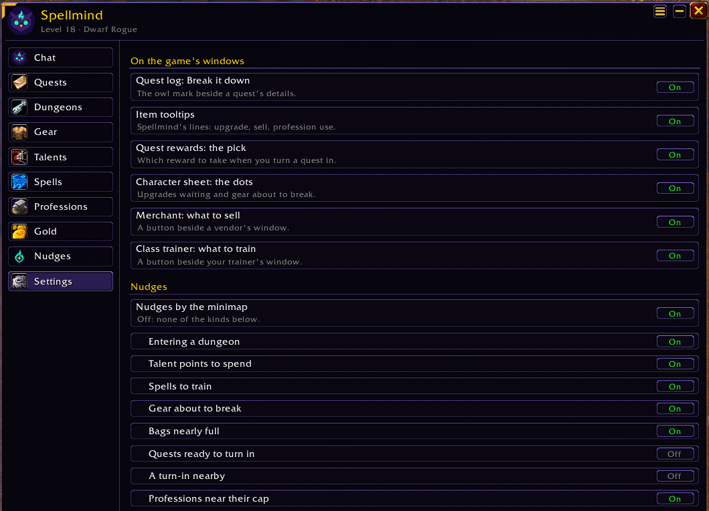
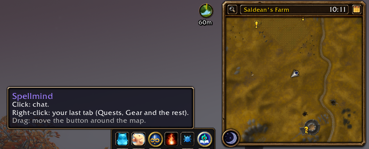
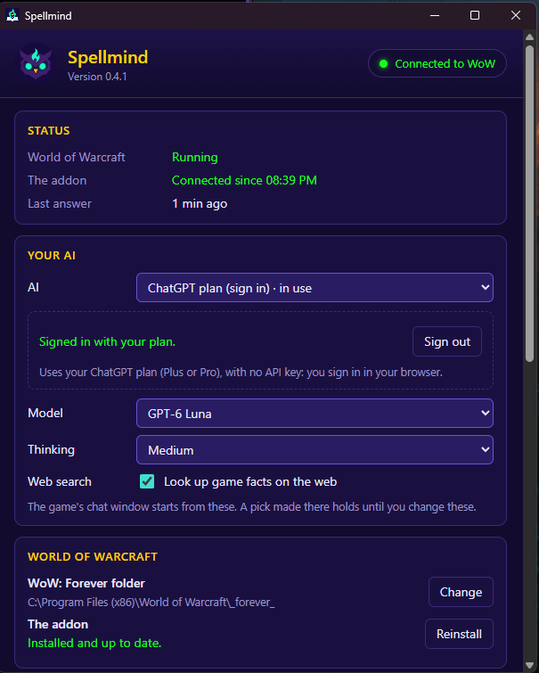

<p align="center">
  
</p>

<h1 align="center">Spellmind: AI Companion</h1>

<p align="center">
  An AI companion for <b>World of Warcraft: Forever</b>. It knows your character as you play and helps with what you're deciding: quests, dungeons, gear, talents, spells, professions and gold.<br>
  <b>Free and open source. Advice only: it never plays for you.</b>
</p>

<p align="center">
  <a href="https://github.com/jcouser/spellmind/releases/latest">Download the app</a> ·
  <a href="docs/install.md">Install guide</a> ·
  <a href="docs/privacy.md">Privacy</a> ·
  <a href="docs/screen-reading.md">How it reads the game</a> ·
  <a href="docs/faq.md">FAQ</a>
</p>

<p align="center">
  
</p>

> **Unofficial.** Spellmind isn't made, reviewed or endorsed by Blizzard Entertainment. World of Warcraft is a trademark of Blizzard Entertainment, Inc.

## What it does

Spellmind is two parts:

- **The addon**, in the game. Its panel works on its own, with no app and no AI: what your quests lead to, which dungeons fit your level, gear and bag advice, talents to take next, spells to train, profession caps and gold. Quiet nudges by the minimap tell you when something's waiting.
- **The free desktop app** (Windows 10 and 11). It sends your question, with the game data you allow, to **your own AI**, and brings the answer back into the game's chat window.

| | Addon alone | Addon + app |
|---|---|---|
| Quests, Dungeons, Gear, Talents, Spells, Professions, Gold tabs | ✓ | ✓ |
| Tooltip lines, nudges, waypoints on click | ✓ | ✓ |
| Chat: ask anything about your character | | ✓ |
| "Break it down" on quests, items, trainers and merchants | | ✓ |
| Read your leveling guide's page (talents, rotation) | | ✓ |

### Ask your AI, in game

<table>
  <tr>
    <td width="55%"></td>
    <td width="45%"></td>
  </tr>
  <tr>
    <td><b>Break it down:</b> click the Spellmind mark on a quest, an item, a trainer or a merchant, and your AI explains that exact thing.</td>
    <td><b>Chat:</b> ask about your gear, bags, route, talents or gold. Shift-click items and quests into the box; the buttons under an answer ask the obvious next question.</td>
  </tr>
</table>

### The panel, no AI needed

<table>
  <tr>
    <td width="50%"></td>
    <td width="50%"></td>
  </tr>
  <tr>
    <td><b>Quests:</b> what to turn in, what to do now and here, and what's worth skipping, with Go to set a waypoint.</td>
    <td><b>Dungeons:</b> which dungeons your quests are for, the questlines that lead there, and what's at your level.</td>
  </tr>
  <tr>
    <td></td>
    <td></td>
  </tr>
  <tr>
    <td><b>Gear:</b> upgrades within reach from your quests' rewards, your weakest slots, and what your bags are good for.</td>
    <td><b>Spells:</b> what to train now and what it costs, what's coming, and your guide's rotation.</td>
  </tr>
  <tr>
    <td></td>
    <td></td>
  </tr>
  <tr>
    <td><b>Talents:</b> your leveling guide's build, read by your AI, with the next points to take.</td>
    <td><b>Settings:</b> every mark and nudge has its own switch, and you choose which game data your AI gets.</td>
  </tr>
  <tr>
    <td align="center"></td>
    <td align="center"></td>
  </tr>
  <tr>
    <td><b>Nudges:</b> a quiet toast by the minimap when something's waiting: spells to train, points to spend, gear about to break.</td>
    <td><b>Tooltips:</b> Spellmind's lines on quests and items: difficulty, what's left, upgrades, what to sell.</td>
  </tr>
  <tr>
    <td colspan="2" align="center"></td>
  </tr>
  <tr>
    <td colspan="2"><b>Minimap button:</b> click for the chat, right-click for your last tab. <code>/sm minimap off</code> hides it.</td>
  </tr>
</table>

### The app

<p>
  
</p>

Pick your AI, its model and thinking level. It sits by the clock while you play, keeps the addon up to date and updates itself.

## Your AI, your choice

The app talks to the AI you pick. You pay that AI (or use a plan you already have); Spellmind itself is free and has no account, server or subscription.

- **ChatGPT plan** (Plus or Pro): sign in in your browser, no API key.
- **An API key** for Claude (Anthropic), ChatGPT (OpenAI), Grok (xAI) or Gemini (Google).
- **Other:** any OpenAI-compatible service, such as OpenRouter or Groq, or a model on your own computer with Ollama or LM Studio.

Keys and sign-ins stay in Windows' Credential Manager on your PC. The game never sees them.

## Install

**The addon:** from CurseForge (WoW Forever), or the `Spellmind-<version>.zip` on the [releases page](https://github.com/jcouser/spellmind/releases/latest), unzipped into `World of Warcraft\_forever_\Interface\AddOns`. The zip carries the addon and its parts (`Spellmind_S001` to `Spellmind_S200`, which bring answers in); keep them all.

**The app:** `Spellmind-Setup-<version>.exe` from the [releases page](https://github.com/jcouser/spellmind/releases/latest). It needs no admin rights, finds your WoW folder, installs the addon if it isn't there, and walks you through setting up your AI. [The install guide](docs/install.md) covers checking the download, the SmartScreen warning, updating and removing it.

In game, `/sm` opens the chat and `/sm help` lists the commands. `/sm app` shows where to get the app.

## Privacy, in short

- **Never sent:** your character's name, realm or guild, your account, other players' names or chat.
- **Sent to your AI only, when you ask:** your question and the game data you allow (class, level, gear, quests, talents and so on; each part has a switch in Settings).
- **Nothing goes to the Spellmind authors.** No telemetry, no analytics, no server.

The details are in [docs/privacy.md](docs/privacy.md).

## How it works

An addon can't reach the internet or write files while you play, so the two parts talk through the screen and the addon folder:

1. The addon draws a small strip of colored squares in the corner of the game's window, holding your question.
2. The app reads only that strip, from the game's window, and sends the question to your AI. [What it reads, and what it doesn't](docs/screen-reading.md).
3. The answer comes back as files in the addon's own folders, which the addon loads.

The app never reads the game's memory, never sends keys or clicks, and never changes the game's files outside Spellmind's own addon folders. [The design notes](docs/design.md) have more.

## Building from source

Node 22.19 or newer.

```
npm ci
npm test                              # the addon (in a Lua VM), the app's core and the link
node tools/package-addon.mjs          # dist/Spellmind-<version>.zip, for CurseForge
cd app/desktop && npm ci && npm start # the app from source
npm run dist                          # (in app/desktop) the Windows installer and its SHA-256
```

The app's screen-reading helper is C, built with `npm run capture:build` (Git Bash with MinGW-w64's gcc) or `core/capture/windows/build.sh` (Zig 0.16.0). Releases are built by [GitHub Actions](.github/workflows/release.yml) from a tagged commit; [docs/releasing.md](docs/releasing.md) has the steps.

## Code signing policy

The Windows installer is being set up for signing through [SignPath Foundation](https://signpath.org)'s free program for open-source projects. Until that's in place, releases are unsigned: check each download against its SHA-256 ([install guide](docs/install.md)).

Once it is: *Free code signing provided by [SignPath.io](https://about.signpath.io), certificate by [SignPath Foundation](https://signpath.org).*

- **Only this project's own files are signed:** the installer built from this repository's source by [the release workflow](.github/workflows/release.yml) on GitHub's own runners, from a tagged commit.
- **Committers and reviewers:** [jcouser](https://github.com/jcouser). Changes from anyone else come as pull requests and are reviewed before they're merged.
- **Approvers:** [jcouser](https://github.com/jcouser) approves each signing request by hand.
- **Privacy:** Spellmind sends nothing to the Spellmind authors. It sends your questions and the game data you allow to the AI you chose, only when you ask, and checks this repository's releases for new versions (a switch turns that off). See [docs/privacy.md](docs/privacy.md).

## Support and security

- Questions and bugs: [GitHub issues](https://github.com/jcouser/spellmind/issues). Leave out your character's name, keys and anything personal.
- Security problems: see [SECURITY.md](SECURITY.md); please don't open a public issue.

## License

MIT, see [LICENSE](LICENSE). Parts come from NeverQuestAlone and wow-ai under the MIT license: see [NOTICE](NOTICE.md). The Spellmind name and artwork aren't covered by the license.
