# The CurseForge listing

What to fill in on CurseForge for the addon, and the rules it has to follow. The project page is created by hand by the maintainer; nothing here uploads anything.

## Project

- **Page:** https://www.curseforge.com/wow/addons/spellmind-ai-companion (project ID 1804129, created and approved 2026-11-14). The ID is the TOC's `X-Curse-Project-ID`.

- **Game:** World of Warcraft. **Game version / flavor:** WoW Forever (interface 16001).
- **Name:** Spellmind: AI Companion
- **Summary** (what CurseForge's search reads most; the names people search for, in a sentence, never a keyword list): *Quest route planner and AI companion for WoW Forever: the shortest way through your quests, on roads players really walk, and ask ChatGPT, Claude, Gemini or Grok about your quests, gear and talents.*
- **Categories:** Quests & Leveling (main), Bags & Inventory, Professions, Map & Minimap. (Not "Companions": on CurseForge that means battle pets.)
- **License:** MIT.
- **Avatar:** `art/curseforge-avatar.png` (400×400, from `art/source/logo.png`).
- **Screenshots:** `docs/images/` (each checked for character, guild and realm names before upload).
- **Release type:** Beta for the first files, until signing is set up and a few players have used it.

## Files

**Uploaded by GitHub Actions** ([curseforge.yml](../.github/workflows/curseforge.yml)) when a GitHub release is published: the release's own `Spellmind-<version>.zip`, its notes as the changelog, as Beta (the variable `CF_RELEASE_TYPE` changes that). It needs the secret `CF_API_TOKEN` and the variable `CF_GAME_VERSION_IDS`; run the workflow by hand with no tag to list the game versions (WoW Forever 1.60.1 is 17053, type 88568 "wow-forever", set 2026-11-14). A release published before it existed is uploaded by running it with that tag.

Upload `Spellmind-<version>.zip` from the GitHub release, the same file, unchanged. It holds the `Spellmind` folder and the 200 `Spellmind_S001`…`Spellmind_S200` parts. The display name is `Spellmind <version>`; the changelog is the GitHub release's notes.

## The rules that matter here

- **No download links for files outside CurseForge** in the description. The app is a separate program, not this project's file, and is linked as the project's home page; the description's last line names the GitHub page, which CurseForge allows.
- **The addon has to work on its own,** and it does: every tab, the tooltip lines and the nudges need no app. The description says plainly which parts need the app.
- **It follows the game's terms:** no automation, nothing that plays for the player. The description says so and links how the app reads the game.
- **No copied text or files from other CurseForge projects.**
- Moderation reviews new projects and files in order, on European working days; a first file can take a day or two.

## Description

As published (Markdown), 2026-11-14; the quest route added for 0.5.0 (2026-11-19) and described in full after its release (2026-11-20); class quests for 0.6.0; shared roads and a step per item for 0.6.5 (2026-11-21); the Linux app and "Check shared roads now" for 0.6.7 (2026-11-25). Paste it into the project's description by hand. Keep it to what the addon does; anything that needs the app says so. The images come from this repository (raw.githubusercontent.com); renaming or moving one in docs/images breaks it here.

> **Spellmind** is a companion for **WoW Forever** that knows your character as you play: your quests, gear, bags, talents, spells and professions. It plans your quest route on the roads players really walk, tells you what to do next, and with the free Spellmind app, it becomes an **AI chatbot** you can ask anything about your character, right in the game.
>
> **Everything in the panel, the tooltips and the nudges works on its own.** No app, no AI, no account. The AI chat is an optional extra.
>
> 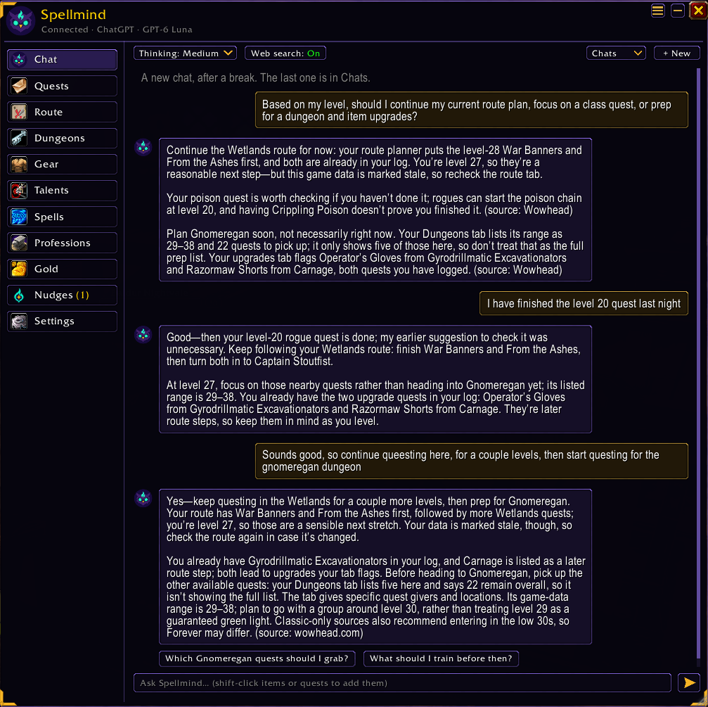
>
> ## Your quest route
>
> Turn it on in the **Route tab** (or `/sm route`). Spellmind plans your leveling from your own quest log and where you stand, keeps the plan up to date as you play, and shows you the way: in a small window that stays on screen, with an arrow, and on the world map and minimap.
>
> 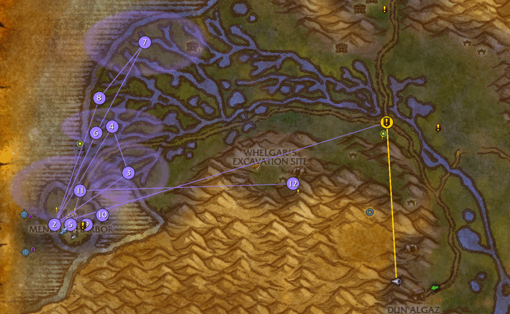
>
> ### How it plans
>
> - **The shortest order that works:** every pickup, objective and turn-in around you, in an order that keeps the quests' own rules: picked up before the objectives, objectives before the turn-in, a chain in order. Follow-up quests are planned after the turn-in that opens them.
> - **Quests that fit you:** quests above your level wait until you're ready (or in a group).
> - **The mobs nearest your way:** a kill or collect step goes to the group of mobs that's least out of your way, not just the biggest.
> - **Worth the walk?** A far quest that gives little XP for the walk is marked "worth skipping?" and comes later. Skip any step, and what needs it goes too; Back brings it back.
> - **Each item where it's got:** a quest's goods each get their own step: "buy Bronze Tube from Billibub Cogspinner", "take the spool (on the ground)", or the mobs that drop it. When another quest in your log needs the same item, it says how many to buy. A vendor seen sold out is noticed, and the next one found.
> - **Up to date by itself:** steps tick off the moment you finish them, and the plan is made again when your quest log changes. It holds still while you're on a flight path.
>
> ### On your screen
>
> - **The route window:** your current step, then the next ones, numbered as on the map, each with what else is done at the same spot. It stays on screen through reloads, where you put it.
> - **The arrow:** points to your next step with the yards to it, along the roads players walk rather than through a wall or a mountain.
> - **The world map:** numbered steps, each objective's area shaded, and a line from you through them.
> - **The minimap:** the current step and the next one, with thin lines to them.
> - **When you're there:** inside an objective's area, the arrow says so and the minimap shades it faintly.
>
> 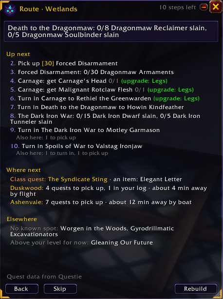
>
> ### Where next, and the way there
>
> - **When a zone runs dry,** Spellmind ranks the best zones for your level by the quests actually left for you there, and the time to get there.
> - **Pick one, and the route takes you there,** holding to it through the zones on the way until you arrive. "Quest here instead" changes your mind.
> - **The way there, leg by leg:** the flight paths you know, the roads between zones, the tram, the boats and your hearthstone. The arrow and the map follow them.
>
> 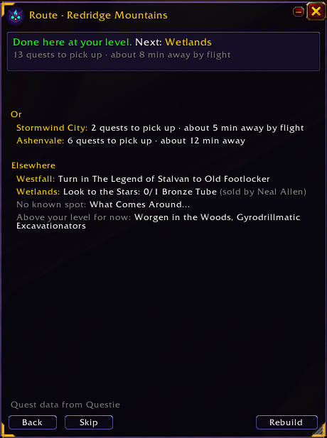
>
> ### And more
>
> - **Ready for a dungeon:** pick a dungeon on the Route tab, and Spellmind routes you through its quests and the questlines that open them, across zones, to its door.
> - **Your class quests:** the questlines for your class, wherever they start, one per level milestone (the versions from other races' starting areas fold under yours). The Quests tab and the Route tab list them with the step you're on; **Route** plans the way through one, across zones. A nudge says when a new one opens at your level.
> - **Roads every player walks:** as you go, Spellmind remembers the ground you walk, so the arrow and the lines follow real paths: along a road as far as it helps, straight across where it's open, round the walls in a city. With the free app, everyone's walking is merged into shared roads that every player's route follows, and they're in every release too. Only squares crossed are shared (no times, no character, no account, and a crossing only once 2 players walked it); "Share the ground I walk" on the Route tab turns it off.
> - **Ask about it:** with the free app, your AI sees the same route. "Review my route" says what to skip and why, with a **Skip** button for each. Without the app, `/sm route why <step>` says why a step is where it is.
> - **A switch for every part** on the Route tab: the window, the arrow, the world map's steps, the minimap, and the lines.
>
> **Works best with Questie installed:** it adds the quests to pick up and where the mobs are. Without it, the route covers the quests in your log.
>
> 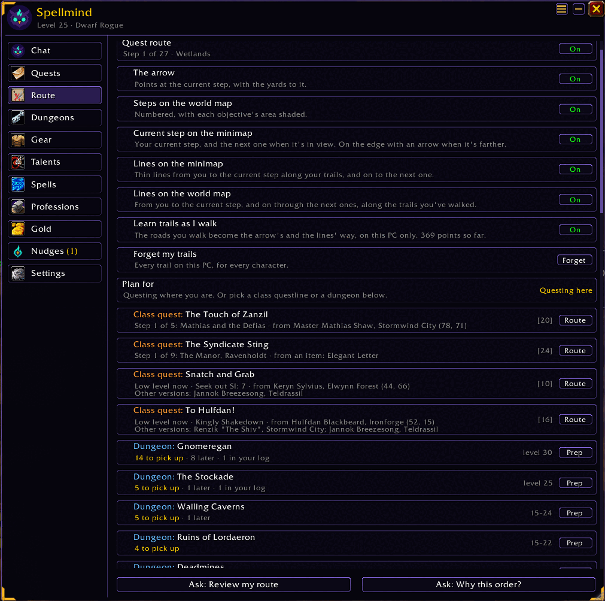
>
> 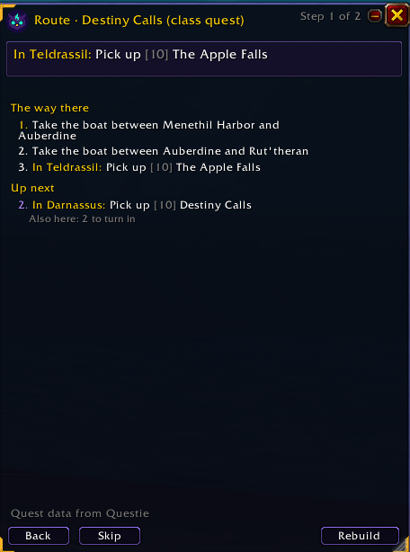
>
> 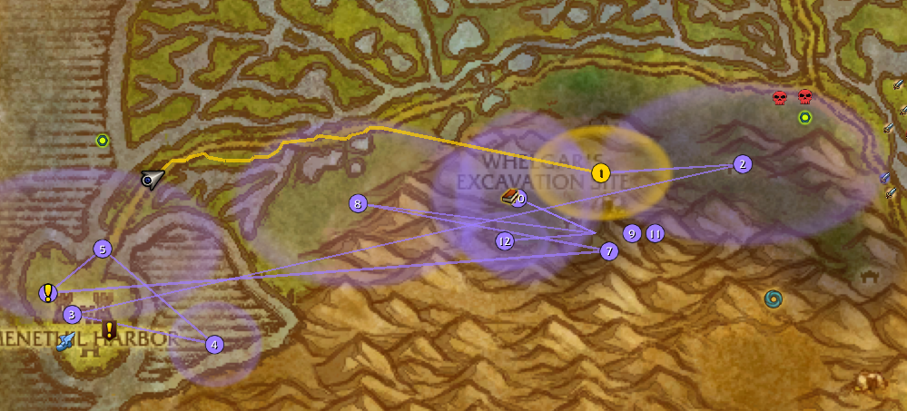
>
> ## The panel
>
> Open it with the minimap button or `/sm`. Each tab shows what matters now and what to do next, live as you play.
>
> - **Quests:** what's ready to turn in and how much of your level that is, what to do here and now, what can wait, and which quests are for a dungeon. **Go** sets the game's waypoint.
> - **Dungeons:** which dungeons your quests are for, the questlines that lead there (the step you're on, who to hand it to, where to pick up the next one), and what's at your level. **LFG** starts a LookingForGroup message for you to send.
> - **Gear:** upgrades within reach from your quests' rewards with their stat changes, your weakest slots, and what your bags are good for: can't use yet, sell, or keep for your profession.
> - **Talents:** what to spend your points on. Import your leveling guide from its link (your AI reads the page, so this one needs the app) and Spellmind follows its build: the next points to take, and when you're behind.
> - **Spells:** what your trainer has for you now and what it costs, what comes at your next levels, and your imported guide's rotation.
> - **Professions:** what to do next for each profession, and when it's near its cap.
> - **Gold:** what came in and went out this session and today (and per hour), what's coming up (spells to train, repairs), and what your bags are worth at a vendor, and on the Auction House from Auctionator's last scan if you have Auctionator.
> - **Nudges** and **Settings:** what's waiting, and a switch for every part of Spellmind.
>
> 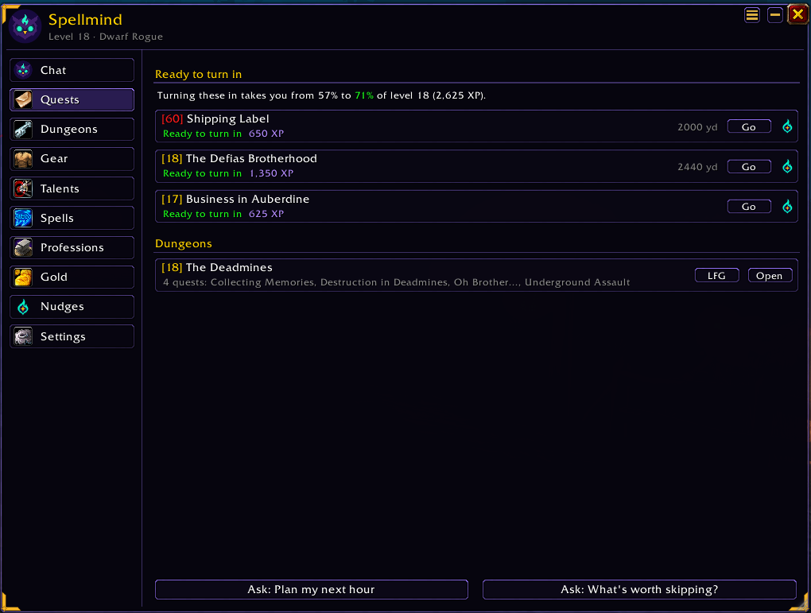
>
> 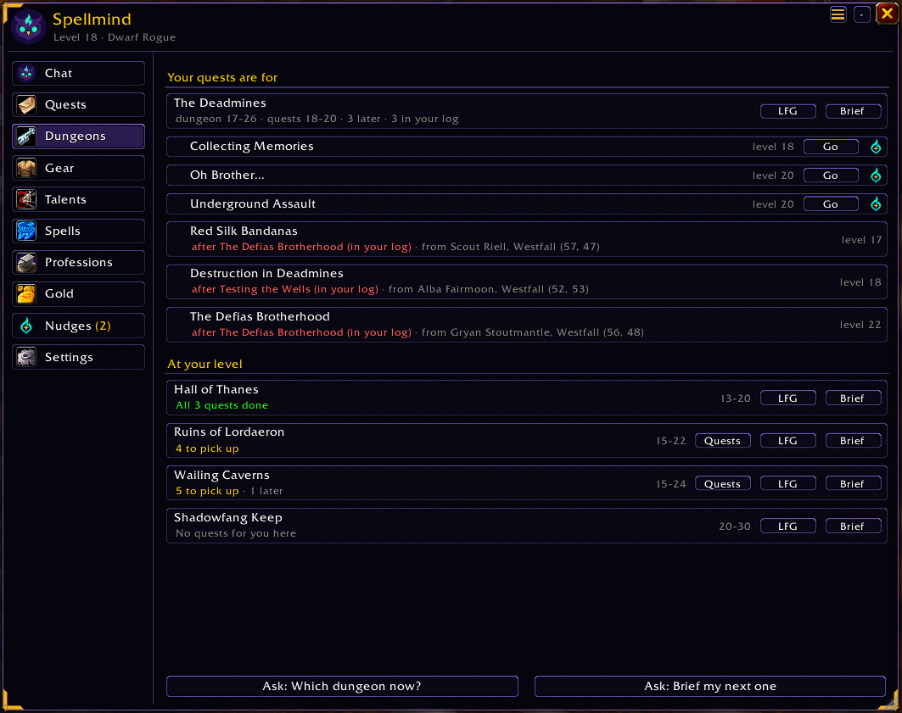
>
> 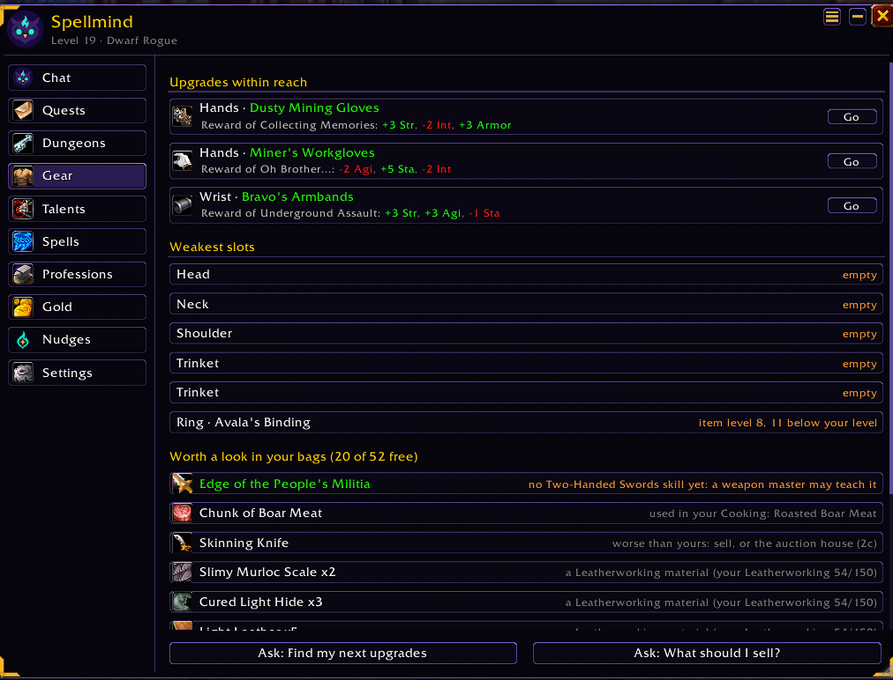
>
> ## In the game's own windows
>
> - **Quest log:** Spellmind's mark on a quest's details. Hover for its level against yours, what's left, where it is and its rewards.
> - **Item tooltips:** a line or two: upgrade or not and by how much, whether you can use it, and what to do with it: sell it, with its vendor price ("sell: grey junk (12c each)"), take it to the Auction House, or keep it for your profession.
> - **Quest rewards:** which reward to pick when you turn a quest in.
> - **Character sheet:** a dot on a slot that has a better item waiting in your bags.
> - **Merchant** and **class trainer:** what to sell, and what to train first.
>
> 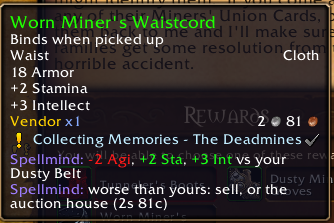
>
> 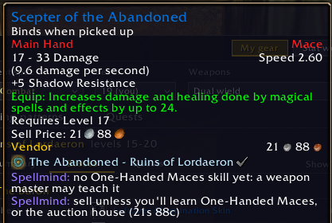
>
> 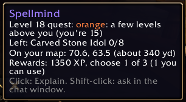
>
> ## Nudges
>
> A small toast by the minimap when something's waiting, never in combat and never a stream of them: spells to train, a class quest ready, talent points to spend, gear about to break, bags nearly full, a dungeon you just entered, professions near their cap. Each kind has its own switch, and **Dismiss** means not again for the same thing.
>
> 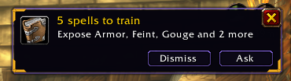
>
> ## Ask your AI (optional, with the free app)
>
> With the free **Spellmind app** for Windows (or Linux, as a preview), ask **your own AI** anything about your character in Spellmind's chat window:
>
> - "Should I take [Dusty Mining Gloves] from this quest?" (shift-click items and quests into the box)
> - "What should I do next here?" / "Review my route"
> - "What in my bags is worth selling on the Auction House?"
> - "Plan my next 5 talent points"
>
> Its answers use your real character: your gear, quest log, talents, gold and where you are. Buttons under an answer ask the obvious next question, and a **Pin** button sets the game's map pin when the answer sends you somewhere.
>
> 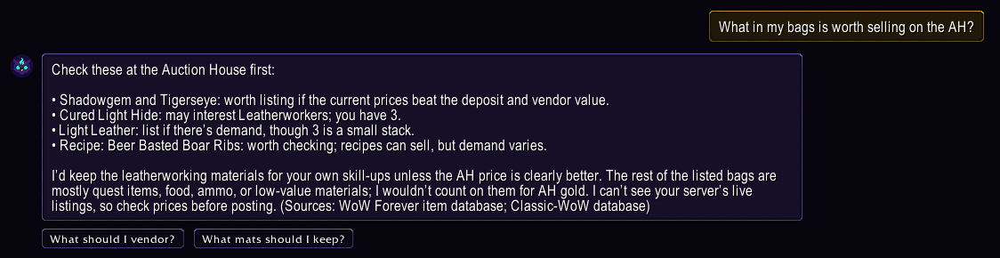
>
> **Break it down:** click Spellmind's mark on a quest, and your AI explains it in steps beside the window: where to go, what you'll need, and whether it's worth doing now.
>
> 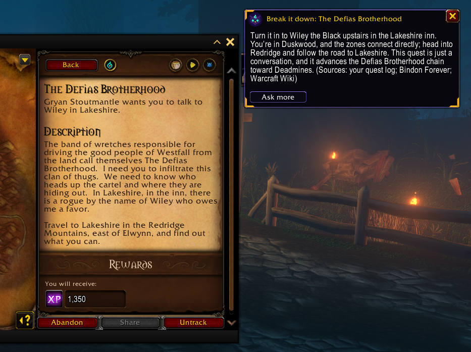
>
> **Your AI, your choice:**
> - A **ChatGPT plan** (Plus or Pro): sign in in your browser, with no API key.
> - An **API key** for **Claude**, **ChatGPT**, **Grok** or **Gemini**.
> - **Other:** OpenRouter, Groq, or a model on your own PC with Ollama or LM Studio.
>
> Pick the model and thinking level; with web search on, your AI can check quest and NPC details online. Answers that name places, NPCs or routes get double-checked first (you can turn that off).
>
> **Shared roads:** the app sends the ground you walk (squares crossed, nothing else) and brings back the paths every player walks, so your route follows real paths in places you've never been. Its window shows how much you've shared and how many players the paths came from; **Check shared roads now** fetches the newest.
>
> Type `/sm app` in game to see where to get the app. It installs and updates the addon too, and updates itself.
>
> 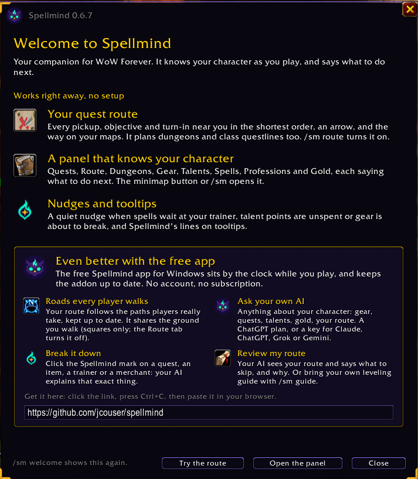
>
> 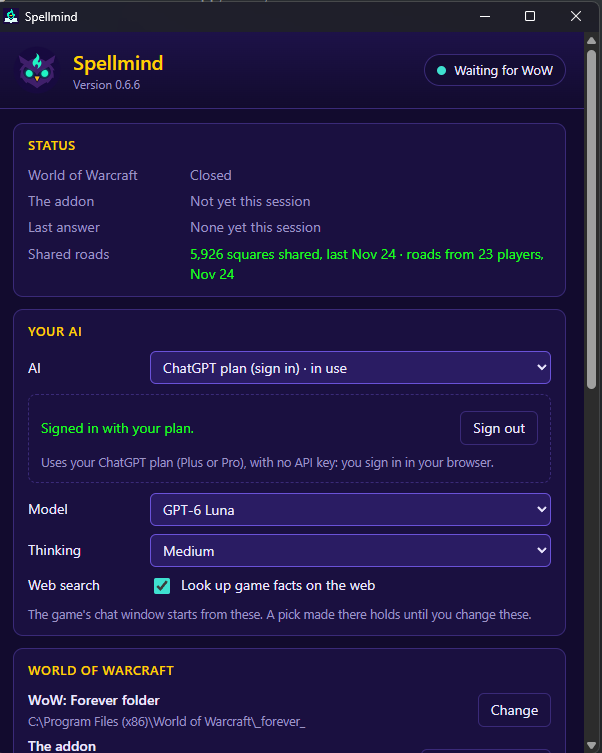
>
> ## Advice only, and private
>
> - **Advice only.** Spellmind never plays for you: it never sends input to the game, never clicks, casts, buys or equips. Waypoints are set only when you click **Go**.
> - **The app reads only Spellmind's own signal strip** from the game's window, and never the game's memory.
> - **Never sent anywhere:** your character's name, realm and guild, your account, other players' names or chat.
> - **Your questions go only to the AI you chose,** only when you ask, with the game data you allow (a switch for each part in Settings). Nothing goes to the Spellmind authors but the ground you walk, for the shared roads (with the app; "Share the ground I walk" on the Route tab turns it off): no telemetry, no account.
>
> ## Commands
>
> | Command | What it does |
> |---|---|
> | `/sm` | Open or close the chat |
> | `/sm quests`, `/sm dungeons`, `/sm gear`, `/sm talents`, `/sm spells`, `/sm professions`, `/sm gold`, `/sm settings` | Open that tab |
> | `/sm <question>` | Ask your AI (with the app) |
> | `/sm app` | Where to get the free app |
> | `/sm route` | The quest route on or off (the Route tab has its switches) |
> | `/sm route why <step>` | Why a step is where it is: what must come before it, and how long the route would be with it earlier |
> | `/sm arrow` | The route's arrow on or off |
> | `/sm news` | What's new in this version |
> | `/sm welcome` | The first-time welcome again |
> | `/sm nudges on`, `off`, `reset` | The nudges |
> | `/sm minimap on`, `off` | The minimap button |
> | `/sm help` | All the commands |
>
> ## Good to know
>
> - **Keep all the "Spellmind Part" addons checked.** They're tiny, load only when an answer comes in, and carry the app's answers into the game.
> - **Works alongside Questie and Auctionator** and uses their data when they're installed, but needs neither.
> - Made for **WoW Forever** (1.60.1). The app runs on Windows 10 and 11, and on Linux as a preview (WoW under Proton or Wine).
> - **The chat never answers?** The app has to be running, WoW restarted once after installing, and every "Spellmind Part" addon ticked. The FAQ (github.com/jcouser/spellmind/blob/main/docs/faq.md) has the rest.
> - Spellmind is unofficial and not made or endorsed by Blizzard Entertainment.
>
> **Found a bug, or an answer that's wrong?** Tell us on GitHub (github.com/jcouser/spellmind/issues), and leave your character's name out of screenshots.
>
> Source code, the app, privacy and how it works: [github.com/jcouser/spellmind](https://github.com/jcouser/spellmind)
